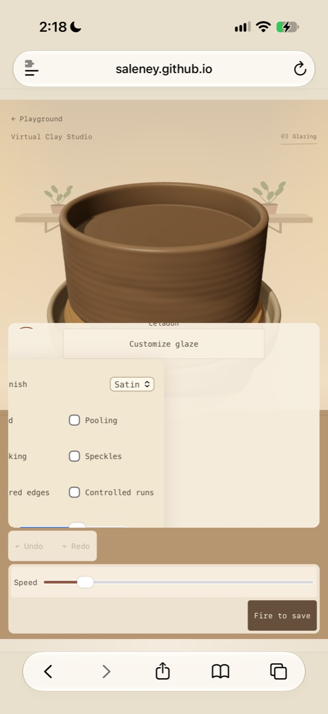
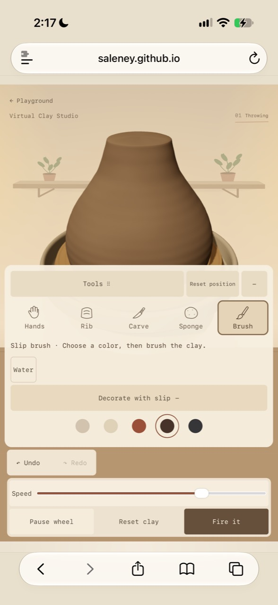
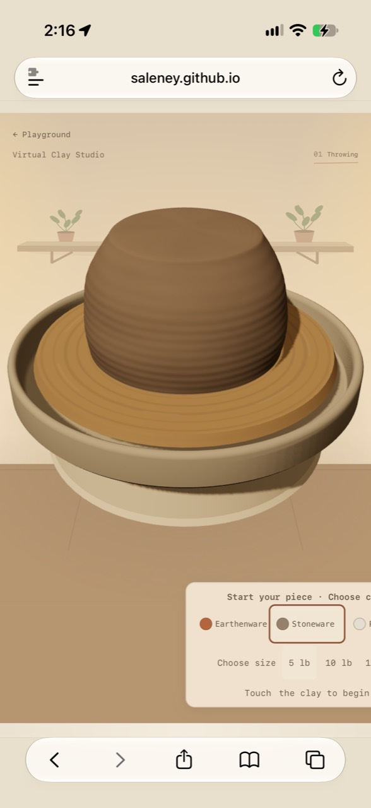

# Virtual Clay Studio controls audit — October 16, 2026

Research and proposal only. Application baseline: `d428628`. No app code, clay/tool behavior, stage logic, shelf storage key, or deployment changed by this audit.

## Recommendation

Give the clay a protected working area, and give the controls their own space. Use a stage-aware control dock below the clay on phones and a persistent side inspector on desktop. Settings should replace the contents of that dock, not grow upward over the vessel. Keep a consistent recovery/action row. Make moving the toolbar an optional desktop convenience only after the fixed layout works.

The underlying problem is spatial ownership: the camera and several independently positioned panels all claim the same pixels. A bigger button or a smaller toolbar alone cannot solve that. The last release improved the collapsed state but left expanded states unsafe.

**Constraint that needs an explicit design decision:** a large vessel, its full touch area, readable settings, and browser chrome cannot always fit at their existing scale into a short 320px-wide viewport. A true “never hidden” guarantee requires a reserved work area plus camera fitting when necessary, or a separate settings view with a persistent unobscured vessel preview. Keeping the existing projected clay size in every state is incompatible with that guarantee. Camera fitting would change presentation, not the clay geometry or tool algorithm; it must preserve accurate pointer mapping and should not shift during a stroke. Do not silently solve this by shrinking the clay everywhere.

## Evidence and limitations

- Reviewed all supplied photos and current `index.html`, `interface.css`, `interface.js`, relevant phase/keyboard handlers in `atelier.js`, and `docs/design-audit-20261011/refinements.md`.
- Browser inventory returned no available browsers, including on resumption. Therefore there are **no new live DOM measurements or stage captures** in this audit. Missing measurements below are deliberately marked, not inferred as passes.
- Supplied photos are 588×1280 image pixels. Their web content is approximately x=0–588, y=179–1145: 588×966. Safari chrome is excluded. Actual CSS viewport width and device pixel ratio cannot be recovered reliably from these images.
- Photo coverage uses manually traced visible clay silhouettes and enclosing control-panel rectangles. These are estimates (roughly ±2–3 percentage points), not pixel-perfect segmentation. Visible clay excludes the wheel. Panel area includes the panel's background and blank space, labels and hints within it; translucency still blocks touch. Header text is excluded from this panel figure; it occupies a small additional area. Overlapping panel rectangles are not double-counted here.
- Hidden clay cannot be measured from a flattened screenshot. We do not invent its silhouette or equate “panel covers half the screen” with “half of the clay is hidden.” Clay sizes/shapes vary between photos; they are not a controlled comparison.
- Coordinates and calculations are retained in `photo-measurements.json`. Original supplied photos are copied unchanged into this folder. Current-version prior screenshots are linked below and labeled as prior captures.
- “Understood within two seconds” is a design target, not a verified fact; no first-time-user study was performed.

## Why it feels wrong

1. **An overlay can be technically visible while making the product unusable.** Photo 3's expanded tools occupy roughly 53% of the content area and intercept the lower clay. Photo 4's glaze customization occupies about 50%, clips options at the left, and makes the panel itself scroll. A rectangle-inside-viewport test is insufficient.
2. **The CSS retains competing layouts.** The starter's mobile `transform:none!important` survives the later `left:50%!important`, leaving the box starting halfway across the viewport (Photo 1). The effects panel becomes `position:static` at compact sizes but retains `transform:translateX(-50%)` from an earlier mobile rule (Photo 4). Compact desktop glaze rules also change left/right positioning without clearing the old tray centering transform: a source-level risk awaiting live reproduction.
3. **The “compact” breakpoint mixes width and height.** `max-width:1100px OR max-height:760px` means a 1280×720 desktop uses a different layout than a 1280×800 desktop. The stage camera does not reserve space based on the actual expanded panel.
4. **Too many controls manage other controls.** Tools drag handle, Reset position, +/−, tool choice, Adjust cut, Customize glaze, Water, Decorate with slip: these compete with making pottery. “+” does not say what it opens. “Reset position” sits near “Reset clay” but affects an entirely different thing.
5. **Clickable and non-clickable text look similar.** Reset clay is intentionally transparent, Undo/Redo are text-like, the selection readout resembles a label/button, and pale nested panels make secondary controls disappear into their containers. A native dropdown, text action, pill, outlined square, and raised swatch express no consistent hierarchy.
6. **Text became smaller after the earlier audit.** Collapsed phone tool labels are now explicitly **9px**. Expanded tool labels are 11px; tool hints are 11px in compact layouts/12px at larger desktop sizes; Reset position is explicitly 9px; most mobile actions are 11px. The older blanket “11px mobile” statement no longer describes the current cascade.
7. **Clutter is also unused area.** Speed gets a full row even in glaze mode while the only primary action sits alone on the next row. Several pale boxes enclose other pale boxes. The mobile gaze must jump between tools, recovery, speed, and progression.
8. **Hidden navigation is a discoverability regression.** The latest rule hides `.bottom-interface > .shelf-link` on every size. The collection still exists below the studio, but discovering it requires scrolling without the visible invitation.

## 1. Button and control inventory

All dimensions below are CSS declarations/minima, **not newly measured bounding boxes**. Width “auto” means label- and flex-dependent. D = desktop/tablet; M = phone ≤620px. T = Throwing; F = Firing; G = Glazing; FF = Final fire; C = completed state within final-fire flow. Unless specified, controls appear on both devices. Selected means persistent state; active means transient press/drag/running feedback. These must not be conflated.

Common current states: buttons receive a 2px focus outline with 4px offset. Generic disabled buttons fade to 50% and use a wait cursor; recovery overrides that to 35%/default cursor. Most controls have no dedicated CSS `:active` feedback. Native selects/checkboxes have browser feedback, but are not covered by the common explicit focus selector. Lists below enumerate every option even when sharing a row.

| Label/control | Purpose and stage/location | Current size/text | Style and states | Inconsistency or risk |
|---|---|---|---|---|
| ← Playground | Leave studio; header, all stages | M 44px-high link; D inline 10px text | Plain link, focus; no selected/disabled state | Desktop hit area not explicitly 44px; looks like incidental text |
| 01 Throwing / 02 Firing / 03 Glazing / 04 Final fire | Progress, header; M only current stage | D ~11px with 9px numerals; M smaller rules down to 8–10px | Current underline/`aria-current`; past dimmed | Not buttons. Can look like tabs; mobile conceals the two-firing sequence |
| Earthenware / Stoneware / Porcelain | Starting family, T before first touch | M ≥44px height, 10px text, 14px dot; D ≥60px height, 11px text, 22px dot; width flexible ≤100px | Transparent default; selected fill/border/2px outline; pressed semantics | Starter wrapper is clipped in Photo 1; long name cramped; different selection treatment from tools |
| 5 lb / 10 lb / 15 lb | Initial amount, T before first touch | ≥44×44px, inherited ~10px | Transparent; selected pale fill/border | Weight looks like text; destructive fresh-start implication is primarily in group accessibility label |
| Tools ⠿ | Move palette, T expanded | ≥44px high, flexible width; 11px | Pale fill, grab cursor; pointer capture; arrows when focused; Escape resets | Not a normal click action despite looking like a button; large space cost on mobile |
| Reset position | Restore palette, T expanded | ≥44px high, auto width; **9px** | Same pale fill as handle; focus; no selected state | Rare action given permanent prominence; ambiguous next to Reset clay |
| − / + | Minimize/expand palette, T | 44px wide ×≥44px; 11px | Pale button; `aria-expanded`; accessible name changes | Symbol alone does not disclose “tool settings”; minimized desktop removes tool names |
| Hands | Shape/open, T palette | ≥44px target; expanded often ≥48/52px; flexible width | Icon+label, hover pale; selected 2px shadow outline/pale fill; `aria-pressed` | M collapsed label9px / expanded11px; D minimized icon only |
| Rib | Compress/guide, T palette | Same as Hands | Same tool states | Name alone requires pottery knowledge; instruction must remain attached |
| Carve | Cut details, T palette | Same as Hands | Same tool states | Tool vs optional settings distinction is not obvious |
| Sponge | Smooth/soften marks, T palette | Same as Hands | Same tool states | Hold behavior needs a short instruction, not another menu |
| Brush | Apply water/slip, T palette | Same as Hands | Same tool states | Name also associated with glaze later; current mode must be visible |
| Rib: Wood / Metal / Rubber | Rib subtype, T when selected and expanded | Select≥44px high, auto width;11px; helper10px | Native dropdown; chosen value | Dropdown style differs from other option types; helper may be smaller than main hint |
| Adjust cut | Show carve settings, T/Carve expanded | Summary≥44px high, auto width;11px compact | Pale fill, +/−, explicit focus; native details open state | Another disclosure within an already expandable palette |
| Tip: Line / Needle / Round scoop | Carve tip, T cut settings | Select≥44px high, max130px;11px | Native selection | Long option needs reserved width; does not share visual language with tools |
| Width (0.6–1.8) / Depth (0.5–1.6) | Cut dimensions, T cut settings | Ranges originally90px; responsive max100%;≥44px high | Native slider, rust accent, focus; no separate selected state | No visible numeric output; adjustments hard to compare |
| Water | Select water brush, T/Brush expanded | ≥44px high; min44–54px wide; M11/D10px | Outlined default; selected brown border/pale fill | Looks like a one-off action, but is a mode; slip selection changes it implicitly |
| Decorate with slip | Open color choices, T/Brush | Summary≥44px high,11px; full row | Filled disclosure; +/−, focus | Full row plus settings competes with clay; open need not mean slip is selected |
| Clay-colored / Cream / Rust / Deep brown / Charcoal slip | Select slip and brush mode, T/Brush/open |44px circle target; colored core smaller due to9–10px transparent border | Selected ring; accessible color names; no visible individual labels | Selected vs focus both rings; color-only identity on touch; tiny visible core looks less tappable |
| ↶ Undo / ↷ Redo | Recover gesture, T/G | ≥64px wide D; M≥72px generally (G rule60px);≥44px high; D10/M11px | Transparent in separate filled box; disabled35%; focus | Faint enabled/disabled ambiguity; independent box adds height; no empty-history explanation |
| Speed, range0–6; number | Wheel rate, T/G and remains in footer through transitions | Slider≥44px high; D preferred220px track, group up to300px; M full row; label11px, D12px | Rust native range; thumb active; numeric output hidden M | Costs44px+spacing on phone; no visible M numeric state; exposed during kiln phase despite primary task being progress |
| Pause wheel / Resume wheel | Toggle rotation, T action row | ≥44px high; D min85px; M flexible;11px compact | Pale secondary, hover; `aria-pressed`; label flips | Selecting speed also resumes wheel; state change not predictable from slider label |
| Reset clay | Discard current shape/start over, T | Same action sizing | **Transparent** unlike Pause; focus; no persistent selection | Looks less clickable; destructive consequence needs separation from routine recovery |
| Fire it | Begin first firing, T | Same action sizing; ≥44px | Dark primary; hover darker; making row hidden F | Vague destination; neither “bisque” nor “ready for glaze” visible on button |
| Back to clay / New clay (intermediate fired row) | Legacy/intermediate actions after first fire | ≥44px; auto width | Pale actions | Present in DOM, but normal handler immediately enters glaze; not a stable discoverable state |
| Celadon / Honey / Cobalt / Ash / Dusty rose / Smoked plum / Chalk / Moss glaze | Select color, G |44px target, M core smaller; horizontal overflow; D8-column arrangement | Color, inset highlight; ring when selected, accessible names | Swatches imply gloss even before final firing; no individual visible names; selection readout separate |
| Glaze · [name] | Selected color feedback, G | M10px; D12px | Plain live text | Not clickable; position can separate it from the swatches it describes |
| Customize glaze | Open finish/effects, G | Summary≥44px high,11px | Pale fill/border; hover/open lighter; explicit focus | Nested panel clips and covers clay; persistent open style weak |
| Piece finish: Satin / Gloss / Matte | Surface finish, G customization | Select≥44px high,12px | Native dropdown | Label and choice far apart on wide panel; native appearance differs by platform |
| Cloud / Pooling / Breaking / Speckles / Layered edges / Controlled runs | Independent finish effects, G customization | Label rows≥44px; native checkbox visual small;11px | Checked native mark; disabled outside G | Six specialist terms with no visual explanation; selected state much stronger/different than other selectors; left-column clipping Photo4 |
| Intensity,0–1 | Amount of selected effects, G customization | Track155px; parent label≥44px;11px | Native range; no visible value | Parent≥44px does not prove actual range drag hit area≥44px |
| Dip whole piece | Apply current glaze to whole vessel, G | Action≥44px; auto width;11px M | Pale secondary, hover; disabled outside G | Immediate paint action; different from Brush/Pour/Spray selector, but “Dip” looks like mode selection |
| Brush / Pour / Spray | Glaze application mode, G | Native select≥44px high, max130px;11px | Chosen option; browser focus | Dip sits outside this mode family; “Size” changes meaning by technique |
| Size,0.1–2.2 / output1.0× | Brush/pour/spray footprint, G | Track75–100px/100% depending rule; **M min-height28px**; output11px | Native range; numeric output | 28px range rule is below requested44px target; actual hit area must be checked |
| Fire to save | Begin second firing, G | Action≥44px; auto width;11px M | Dark primary; disabled during FF; hidden via firing phase rules | Combines material transformation and storage; suggests file saving rather than kiln |
| Glaze again | Return completed piece to glazing, C | Action≥44px;auto width | Pale secondary; hover/focus | Important reusable flow; must stay out of clay area |
| New clay (completed row) | Start next piece, C | Action≥44px;auto width | **Dark primary**, whereas T reset and intermediate New clay are pale/transparent | Same start-fresh family changes appearance by stage; reasonable priority change but needs consistent naming |
| Your shelf ↓ | Navigate to saved collection, intended all stages | Legacy36–44px link | Now `display:none` globally | Missing route to successful outcome |
| Back to the wheel ↑ | Collection → workspace |≥44px high,9–10px | Text link/focus | Small label despite generous hit area |
| Save image (each saved piece) | Download PNG, collection |min-height36px declaration;8px padding;9px; anchor not guaranteed block hit area | Text link/focus | Does not establish44×44 target; too quiet for recovery from failed storage |
| Clay canvas | Direct manipulation, T/G; view through F/FF/C | Projected clay inside full canvas, not a button | Focus outline, tool cursor; pointer gestures; arrows/Enter/Space depending mode | DOM canvas bounds are not clay bounds. Overlay panels intercept touches even when translucent |

Noninteractive messages: first invitation, active-tool hint, kiln temperature/progress (`role=status`), “Ready for glaze,” save-status/warning, “Revealed in the final firing.” Keep these in the inventory of occupied space, but do not style them like buttons. Much status text is visually hidden; an accessibility announcement is not a visible explanation for a sighted beginner.

## 2. Visibility measurements

### Supplied real-phone evidence

Percentages use web content area only. “Visible clay” is an approximate silhouette fraction; “panels” is the enclosing UI area including hints and blank panel space. These quantities are not complements. Background, wheel and header account for the remainder.

| Screenshot | State | Visible clay / content | Panels / content | Clay and access finding |
|---|---|---:|---:|---|
| [Photo1](user-1.jpg) | Starter | ~14% | ~10% visible portion only | Clay clear; large part of chooser off-screen. Low panel percentage is not success. |
| [Photo2](user-2.jpg) | Throwing, collapsed | ~28% | ~24% | Clay body clear of dock, but top nearly touches viewport edge; little growth margin. |
| [Photo3](user-3.jpg) | Throwing, Brush/slip expanded | ~11% visible | ~53% | Lower body hidden/intercepted. True full-clay area and hidden fraction unknown. |
| [Photo4](user-4.jpg) | Glazing, customization expanded | ~15% visible | ~50% | Lower body hidden; left-side options and bottom content clipped. |
| [Photo5](user-5.jpg) | Glazing, customization closed | ~16% | ~37% | Clay body clear, lower wheel obscured; controls dominate despite many small labels. |

**Three worst screens:** (1) Photo4—loss of both controls and clay access; (2) Photo3—expanded tools obstruct the surface being worked; (3) Photo1—initial choices leave the viewport before the user even begins. Photo2 is not an adequate regression target by itself.

### Requested width × stage matrix: evidence status

A width alone is insufficient; height and browser chrome matter. Proposed standard test dimensions below are explicit. “Missing” means not measured, not passed. Existing screenshots use a different form/size from the user's tall vessel and cannot establish a guarantee.

| Width × content height | Throwing evidence | Firing | Glazing | Final fire |
|---|---|---|---|---|
|320×568|[Prior collapsed5lb capture](../palette-shoulder-review/phone-320.png): body clear, controls below; panel estimate~33% of viewport|Missing|Missing|Missing|
|390×664|[Prior collapsed5lb capture](../palette-shoulder-review/phone-390.png): body clear; panel estimate~29%|Missing|Missing|Missing|
|430×740|[Prior expanded Rib5lb capture](../palette-shoulder-review/phone-430-expanded.png): body clear, wheel partly covered; panel estimate~44%|Missing|Missing|Missing|
|768×1024 tablet portrait|Missing|Missing|Missing|Missing|
|1280×800 desktop target|Missing; [prior1280×720 trial](../palette-shoulder-review/gesture-03-shoulder.png) shows clear body with left palette, but is a different height|Missing|Missing|Missing|

Prior phone panel estimates use enclosing rectangles from the saved images, rounded to whole percentages; they include footer/recovery/dock, exclude header. They are not a fresh cross-browser run. Additional observed desktop: [1024×650 minimized](../palette-shoulder-review/desktop-minimized.png), clear body, ~14% panel area. Do not substitute this for tablet testing.

At a CSS maximum height of40dvh, an expanded phone palette alone can occupy nearly40% of the screen width/height area. Add the100px footer and44px recovery row and short screens have very little uncontested space. This is a budget explanation, not a measured screenshot result. Firing hides tool palettes and recovery in code but leaves the footer/speed and an overlay phase note; tall-form message overlap needs actual capture. Final fire must be measured both during the kiln animation and after completion/save messages.

### Worst-screen gallery

Glazing customization—clipped controls and obstructed clay:

Expanded Brush/slip—panel intercepts the clay:

Starter—choices leave the viewport:

### Exact follow-up measurement protocol (before approving an implementation)

- Same form and camera per comparison: 5/10/15lb starter, tall cylinder, wide bowl, rounded closed-mouth vessel. Use real gestures to establish representative states; no injected success profile.
- At every listed viewport, capture starter; collapsed/expanded Hands/Rib/Carve/Brush+slip; Firing mid-animation; Glazing closed/open customization; FF mid-animation; completed; save warning. Also test1280×720, tablet landscape, and mobile toolbar expanded/collapsed chrome.
- Obtain projected clay silhouette/bounds separately from DOM canvas. Report visible clay area/viewport, UI union area/viewport, UI∩clay area/clay, and pointer-reachable clay fraction. A translucent panel counts as obstructing if it intercepts input. Report header, hints and messages as separate union regions.
- Require zero UI∩clay and zero clipped controls; record any top/side clipping separately. Verify pointer reach on rim, shoulder, belly and foot, not merely the center of canvas.
- Expand settings and resize without changing the vessel. Test200% text enlargement and320px reflow. Retest keyboard/focus, both handedness modes and all existing regression suites. Native iOS Safari must be represented; desktop viewport emulation alone did not catch the supplied failures.

## 3. A small proposed button system

Numbers are design recommendations, not WCAG-mandated font sizes. Retain native semantic buttons/selects/details/ranges. Use one foreground ink with verified4.5:1 normal-text contrast; distinguish selected controls with more than color. Check non-text boundaries/focus at3:1 against adjacent colors. Keep every interactive target≥44×44px, preferably48px on touch.

| Type | Proposed dimensions | Label rule | Default / selected / disabled / active |
|---|---|---|---|
|Primary progression|48px high touch;44–48px desktop;min96px wide,12–16px horizontal padding|One verb+destination, single line: “Fire clay” / “Fire glaze”; nearby stage text can clarify bisque/final. Same four stages, no behavior change.|Dark fill/light text; hover darkens; press darkens+inset border without motion; disabled retains legible text and clear unavailable treatment; running swaps to progress text in reserved status area. No selected state.|
|Tool selector|56px high touch with icon+label; desktop44–48px horizontal icon+label; width fits label|Hands/Rib/Carve/Sponge/Brush stay attached to icons. Never hide all names as the default.|Neutral bounded surface; selected2px ink border+warm fill+pressed semantics; hover light tint; keyboard focus separate outer ring; transient press distinct from selection.|
|Material/color choice|44–48px minimum hit box with28–32px color sample; named card when space permits|Clay family always named. Colors show short name beside/under selected sample; all names accessible; hover/focus name supplement only.|Default thin boundary; selected ring+check; pressed state; no reliance on hue alone. Do not pre-promise glass gloss on an unfired swatch.|
|Recovery|44–48px high, label+small icon; auto width|Undo/Redo. “New clay” separated from Undo/Redo; any destructive reset needs clear wording and existing recovery semantics preserved.|Neutral outlined button, not faint text; disabled legible but visibly unavailable; hover and press fill; focus ring. Selected N/A.|
|Secondary / disclosure|44–48px high, label-fit width|“Tool settings,” “Glaze effects,” “Close settings”; chevron accompanies words. One label, one control; no lone+/− as the only explanation.|Neutral fill+visible border; open state chevron/`aria-expanded`; hover/press tint; same focus.|
|Field control (supporting type)|Select≥44px high; range hit zone≥44px high, track120–180px where practical; checkbox row≥44px|Permanent label and value. Keep “Size” with method; use “Brush size” or corresponding selected method label.|Native semantics; visible focus on select/summary too; disabled explains context; slider value remains visible on mobile.|

Spacing:4px icon-to-label only in compact stacked tools,8px related controls,12–16px between groups. Do not stretch a label away from its control to fill a row. Default borders1px, selected2px without layout shift, corners6–8px. Avoid nested pale cards; one panel background and distinct control boundaries are enough. Motion is optional feedback; reduced-motion users get the same state cues without animation.

### Readable sizes and the cost in space

| Breakpoint | Action/field text | Tool names | Hint/status text | Space cost / arrangement |
|---|---:|---:|---:|---|
|320px|14px actions,16px native fields|14px|14px/20px line-height|Five tool cells need roughly≥340px including padding/gaps at these labels. Use an explicitly scrollable labeled row or3+2 grid; never squeeze to9px. Grid adds one56px row+8px gap. Settings replace dock content.|
|390px|14–15px actions,16px fields|14px|14px/20px|Five cells can fit at~70px each with tight gaps, but do not add a sixth+ cell to the same row. Settings button gets its own designated position.|
|430px|15px actions,16px fields|14px|14px/20px|A five-tool row is comfortable; longer actions still get label-fit widths. About4–8px extra text height per control compared with11px, often absorbed inside48px targets.|
|Tablet768px|15–16px|14–15px|15px/22px|Can afford a224–240px inspector in landscape; portrait may use phone dock. Allocate by remaining canvas dimensions, not device name.|
|Desktop1280px|14–15px;16px if desired for forms|14px|14px/20px|Use a224–256px side inspector and44px rows. More width should reduce wrapping, not create giant buttons.|

At fixed font family,11→14px expands text width by~27%;9→14px by~56%. That is why increasing type alone breaks the existing five-tools-plus-toggle row. “Controlled runs” at14px monospace is roughly126px before its checkbox and gap; two such columns need more than320px after padding. At320px use one effect column in the settings view. Label wrapping is allowed for explanatory text, not awkwardly across a button; choose another arrangement instead of truncating essential action text. At200% text size the layout must reflow rather than retain single-line controls at any cost.

Suggested phone budget: header40–48px; working dock~144–184px when compact; rest belongs to clay with clearance. At320×568 that leaves about336–384px before safe areas; a taller vessel may need presentation fitting. These are starting design budgets, not validated promises. The clay's occupied height must be measured, not assumed from the wheel's width.

## 4. Mobile layout options, ranked by implementation risk

All four preserve clay behavior, stage logic and saved-shelf key. “Risk” includes implementation complexity and interaction surprises. No option is implemented.

| Rank/option | What changes | Clay visibility and type | Risks/tradeoffs |
|---|---|---|---|
|1. Fixed dock with explicit collapsible settings — lowest risk|Separate canvas and dock in normal layout; labeled tools plus “Tool settings”; settings replace tools temporarily, with Back. Footer stays predictable.|14px labels,44–48px targets. Settings cannot overlay canvas. At320 use scroll row or3+2 tools.|Additional tap to settings; fixed dock reserves space even when lightly used. May need camera fitting for tall clay. Does not by itself simplify stage-specific content.|
|2. Stage-aware fixed dock — recommended, moderate risk|Build on1. Starter choices, Throwing tools, kiln progress, Glazing choices and completed actions occupy the same bounded region at different times. One settings view at a time; recovery/action placement stays consistent.|Most unused controls disappear by context. F/FF get clear clay and a status strip.14–16px labels fit through substitution rather than stacking.|Need exhaustive phase-transition/focus tests; control changes can surprise users unless stable anchors and stage label remain. Hide presentation only; don't rewrite stage logic.|
|3. Reserved side rail with settings inspector — medium/high risk on phones|Left or right rail for tools, dedicated panel for selected settings, with an explicit handedness preference.|Good central vertical room;44–48px cells and14px labels. Desktop adaptation strong.|On320px, a64–80px rail leaves240–256px for clay, likely shrinking its horizontal projection. Labels may need a wider rail. Not recommended as phone default.|
|4. Movable palette with constrained docking — highest risk|Dedicated drag handle; dock to defined left/right/bottom safe zones; optional minimize; reset available in settings, not permanent prime space.|Can help users choose thumb side. It guarantees visibility only if forbidden from overlapping the clay work area; free-floating cannot meet goal1.|Accidental handle drags, lost palette, gesture competition, position memory, rotation/resizing, and accessibility add complexity. Small mobile screens have few genuinely safe locations.|

### Honest movable-toolbar assessment

- **Accidental drags:** a dedicated handle avoids treating every button as drag initiation, but current implementation begins movement immediately with no drag threshold. A finger aiming at the upper tool row can still move the panel. Proposed: explicit Arrange action or a clear handle plus threshold, pointer cancellation and no sculpting gesture simultaneously.
- **Thumb reach:** bottom placement works differently for one-handed use and two-handed tablet use. A free palette can drift above comfortable reach. Do not rely on reach estimates as proof; test actual devices.
- **Left/right hands:** offer mirrored docking choices. Keep tool order and reading order stable; do not infer handedness from one drag. The chosen side must not cover the rim/foot.
- **Discoverability:** “Tools ⠿” suggests movement mainly to experienced users;+/− is even less clear. A short optional first-use explanation and visible dock choices are easier than making users discover free dragging.
- **Remembering position:** current code does NOT persist position; resize resets it. Proposed memory should store a dock choice per layout class, not rawx/y coordinates that place controls off-screen after rotation. This can use a separate preference key; never repurpose the saved-shelf key. Add an always-reachable reset.
- **Keyboard/accessibility:** current handle supports arrows and Escape, which is a useful base. Proposed movement needs discoverable instructions and announcements; menus/controls retain logical tab order independent of visual position. During native select/slider use, shortcuts must not hijack input.
- **Recommendation:** postpone free movement on phones. On desktop optional constrained docking can be added after the default fixed layout proves reliable.

## 5. Overall direction, including desktop

Choose **Option2: a stage-aware fixed dock on phones and a fixed side inspector on desktop**. Make the work surface a separate layout region; never position controls over it. Reuse the same small button system across both, but do not reuse the same arrangement.

Desktop: a224–256px left tool/inspector column, a large central canvas, and a compact footer aligned to that canvas. Put selected-tool settings and its short hint together in the inspector. Glazing replaces that inspector with named colors, method and finish controls. Use spare width for readable labels, not an enormous full-width control bar. Tablet switches based on available canvas width AND height. Optional left/right docking can come later.

Pointer/keyboard: visible hover for every actionable control; names/shortcuts on hover AND focus, not hover alone. Preserve Cmd/Ctrl+Z, Shift+Cmd/Ctrl+Z/Ctrl+Y; expose those in a small shortcuts help entry. Preserve existing focused-canvas arrows/Enter/Space. Optional tool shortcuts could be added only with a focus-aware specification; do not introduce a global Space shortcut that collides with buttons, sliders or text input. Never require keyboard shortcuts to discover an action. Select/summary focus should be explicitly styled as well as buttons/ranges. Keep touch targets44px even on desktop; precision can improve spacing and preview, without shrinking click targets.

First-use language: a named selected tool plus one short next gesture (“Hands · Drag down in the center to open”). Glaze mode should show the selected color and application method together. Keep one progression action, and explain the kiln through the existing stage/progress presentation. Reset should look like a button but sit apart from routine Undo. Show Your shelf again after completion. No new tutorial overlay is necessary to compensate for an unclear layout.

The two-second target should be checked with first-time participants: ask them to select a tool, change its setting, pause, undo, choose glaze and start the final fire without coaching. Record hesitation, wrong clicks and missed controls; don't treat a developer's successful click-through as proof of intuitiveness.

## Acceptance criteria for a later chosen implementation

- Zero control/hint/message overlap with the clay silhouette plus a practical finger clearance margin (start with16–24px and validate), in every tested stage/state and size. Camera fitting occurs only between gestures, never jumps under an active finger.
- No off-screen starter choices or effects; no horizontal page overflow. Settings scroll internally only when clearly indicated, with the clay remaining separately visible.
- All hit targets≥44×44px, actual range hit zones included. Visible selected/disabled/focus states;200% text resize and320px reflow.
- No changes to Hands/Rib/Sponge/Carve/Brush algorithms, four-stage transitions, history semantics, final-firing effect reveal, or saved-shelf key. Geometry and existing workflow suites remain required.
- Regression tests must measure clay overlap and actual click interception, not only button rectangles or viewport containment. Test expanded states and native Safari.

## Sources

- [W3C Reflow](https://www.w3.org/WAI/WCAG21/Understanding/reflow):320 CSS-pixel reflow benchmark; relevant to clipped options, although the3D scene itself has distinct spatial needs.
- [W3C Resize Text](https://www.w3.org/WAI/WCAG21/Understanding/resize-text):200% enlargement without losing controls/content.
- [WCAG2.2](https://www.w3.org/TR/WCAG22/):contrast, focus and target criteria.44×44 is the project's retained requirement and the enhanced target-size criterion; it is stricter than the24px minimum criterion. WCAG does not prescribe a universal14/16px body font; those are recommendations here.

## Regression check

All eight existing code suites passed during this documentation-only audit: connected-clay, gentle-carving, glaze-coverage, glaze-finish, interior-stability, rib, shelf-saving, and water-and-smoothing. Output is in regression-results.txt. This is not a replacement for the missing live layout matrix.

## Status

Proposal ready for choice; live measurement matrix incomplete because browser access is unavailable. Only documentation/evidence files are changed. No deployment. Do not interpret the photographed or prior-capture results as complete cross-device certification.
